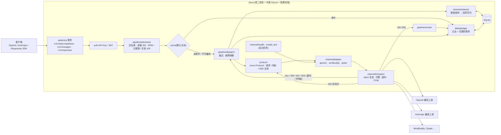

# Aikun 重构方案与进度(refactor/modular-gateway)

> 状态:roadmap-v0.5 **阶段 0 与阶段 1(结构重组)已完成**(阶段 1 遗留的协议契约测试已随结构迁移步骤 4 落雏形:非流式双向黄金样本 + 官方 spec 快照,流式样本仍留阶段 2);**阶段 3 已随 plan 步骤 8 主体落地**(见 7.4);阶段 2、4 未开始。
> 结构迁移(architecture-v0.5 §五)**步骤 2–8 已全部落地**(2026-11-17 回写):workspace 完整化(虚拟清单 `members = ["aikun", "crates/*"]`,二进制移入 `aikun/`)、`crates/aikun-protocol` / `aikun-channels` / `aikun-admin` / `aikun-store` 四 crate 就位、CI regenerate 守卫已上;**管理面 API 全部 tag 完成 spec-first 迁移**——旧 `/api/admin/**` 与旧用户自助 handler 删除、前端切换完成,行为变化单列 CHANGELOG,二进制版本升 **0.5.0**(版本门禁可用)。完整清单与验收标准见 `docs/plan-next-steps.md`。
> 第 9 节最佳实践已写入对应阶段任务;除 9.7 的部分缓存约束与 9.1 非流式样本外,代码尚未实施。
> 分支 `refactor/modular-gateway`,`cargo fmt --check` 与 `cargo clippy --all-targets -- -D warnings` 零告警;阶段 0/1 完成时 `cargo test --locked` 全绿(148 单测 + 42 e2e;基线 v0.4.4 为 130 + 38)。结构迁移后 e2e 拆为 `e2e.rs` + 6 个 tag 独立目标(静态统计 65 个 `#[tokio::test]`),全绿以 CI 门禁为准。
>
> **优先级:`docs/roadmap-v0.5.md`(阶段与纪律)> `docs/architecture-v0.5.md`(目标结构)> 本文。** 冲突时按此序裁决;本文只记录落地方式、未覆盖的用户需求,以及各条目的进度。结构类决策(多 crate workspace、admin API spec-first、channels crate)见 architecture-v0.5.md 的决策记录。
>
> 来源标注:
> - **【用户 roadmap】**:`docs/roadmap-v0.5.md`(状态"已定稿,施工中以此为准")
> - **【用户需求】**:与用户沟通中明确提出、roadmap 未覆盖的需求(缓存层;WorkBuddy / Qoder 等新渠道好接入)
> - **【网关设计】**:此前讨论的模块化 AI 网关设计(协议层 / 路由 / Channel trait + 注册表 / CacheBackend)
> - **【现有实现】**:Aikun v0.4.4 已有、保持不变的能力
> - **【本次新增】**:为落地上述各项新做的决策

## 0. 用户 roadmap 与本方案的合并

### 0.1 用户 roadmap 要点【用户 roadmap】

**定位**:0.5 是重构版(还债版),不新增大的对外能力。**每个阶段结束时 e2e 必须全绿,禁止推倒重写。**

**必须保留的三项资产**:三端点单管线(`proxy_completion`)、以 OpenAI chat 为枢纽的星型协议转换、微元整数计费 + 单事务落库。

**四条关键决策**:
1. passthrough 改为管线的一种模式(`NoConversion + OpenAiOnly + NoStream`),不再单独维护第四条管线;
2. `enum Protocol` + 穷举 match,消灭静默兜底;
3. 转换边界类型化,枢纽维持 Value 树(不做全面 IR 重写);
4. 拓扑走缓存、事实走 DB:渠道 registry 快照、价格缓存、日额度计数器表。

**明确不做**:多实例 / 状态外置 Redis / PostgreSQL(仓储 trait 留缝即可)、插件系统、前端框架化、新的管理端大功能。

| # | roadmap 条目 | 阶段 | 本分支状态 |
|---|---|---|---|
| P0-1 | passthrough 复刻整条管线 | 2 | ⏳ 未开始 |
| P0-2 | God function / 14 参 `attempt_loop`、11 参 `stream_response` | 2 | 🟡 已分到 `pipeline/dispatch.rs` / `pipeline/stream.rs`(纯移动),`RequestCtx` 与拆小未做 |
| P0-3 | convert.rs 巨石 + `&'static str` 协议 + 静默兜底 | 1 | ✅ 已拆为 `protocol/` 目录树;`enum Protocol` 穷举 match |
| P0-4 | handler 内写 SQL、无仓储层、db 反向调用 billing 播种 | 3 | ⏳ 未开始 |
| P1-5 | 热路径全表扫描(选路 / 价格 / 日额度 SUM) | 3 | ⏳ 未开始 |
| P1-6 | 3 个潜伏 bug | 0 | ✅ 已修,各有回归测试 |
| P2-7 | 测试哑铃形、缺登录 e2e | 0 / 1 / 2 | 🟡 登录链路 e2e 已补;协议契约测试(第 9.1 节)为阶段 1 遗留、流式部分在阶段 2;handler 单测留到阶段 2 |
| P2-8 | CI 无 fmt / clippy、无 CHANGELOG、providers.js 弹窗重复 | 0 / 4 | 🟢 CHANGELOG 已建;fmt / clippy 门禁已上(见 7.1);前端去重在阶段 4 |
| P2-9 | 无 request_id / metrics | 2 / 4 | ⏳ 未开始;可观测性打点提前到阶段 2,`/metrics` 仍在阶段 4 从 span 汇总(第 9.6 节) |

### 0.2 冲突与裁决

| # | 冲突点 | 此前方案 | roadmap | 裁决 |
|---|---|---|---|---|
| 1 | 模块命名与目录 | `gateway/`、`channels/`、`router/`、`protocol/convert.rs` 单文件 | `pipeline/`、`channel/`、`protocol/{openai,anthropic,responses}/` | **按 roadmap 改名**:`gateway/` → `pipeline/`,`channels/` + `router/` → `channel/`,convert.rs 按 roadmap 拆分 |
| 2 | 渠道"插件"层 | `channels/` 插件 trait + 注册表 | 明确不做插件系统 | **保留 `ChannelAdapter`,但重新定位为编译期静态适配器**:位于 `channel/adapter/`,不支持动态加载,不提供外部 ABI,文案统一改为"适配器"。理由:【用户需求】明确要求新渠道(WorkBuddy、Qoder)容易接入,适配器只是把原先散落在 client / health / fetch-models 三处的 URL 与鉴权逻辑收成一处,与 roadmap 要求 health 复用 `apply_auth` 方向一致。`channel/registry.rs` 这个名字留给 roadmap 阶段 3 的渠道快照 |
| 3 | Redis 缓存后端 | `redis-cache` 编译特性 | 明确不做状态外置 Redis | **删除 Redis 后端与特性**,同时删掉 `AIKUN_CACHE_BACKEND` / `AIKUN_REDIS_URL`。`CacheBackend` trait 保留为接缝,唯一实现是进程内 `MemoryCache` |
| 4 | 响应缓存这个新功能本身 | 新增网关侧缓存 | 0.5 不新增大的对外能力 | **保留,默认关闭**(`AIKUN_CACHE_MODE=off`,升级后行为不变)。理由:【用户需求】明确提出;实现局限在 `cache/` 加管线里一个分支。按 roadmap 纪律在 CHANGELOG 单列"新增"条目。若要严格按 roadmap 执行,可以把 `feat(cache)` 与 `feat(channels)` 两个提交拆到单独分支,其余提交不依赖它们的行为 |
| 5 | 协议标识 | `&'static str` 常量 | `enum Protocol` | **按 roadmap**:`protocol::Protocol`,字符串只出现在 DB / 日志 / JSON 边界 |
| 6 | 管线拆分粒度 | `gateway/pipeline.rs` 单文件 | `pipeline/{mod,context,dispatch,stream,error}.rs` | **按 roadmap 落文件**:`mod.rs` / `dispatch.rs` / `stream.rs` / `admission.rs` 已就位;`context.rs`(RequestCtx)与 `error.rs`(GatewayError)属于阶段 2,未做 |
| 7 | 错误形状归属 | 留在网关管线 | 下沉到 `protocol/` | **按 roadmap**:`protocol/error.rs` |
| 8 | 后续计划 | 自拟的"第二阶段"清单 | 阶段 0–4 | **作废自拟清单**,统一用 roadmap 的阶段编号(第 7 节);自拟清单里 roadmap 未覆盖的条目(WorkBuddy / Qoder 真实协议、Azure 适配器、缓存命中率)列为"roadmap 外待办" |
| 9 | 配置方式 | 【网关设计】用 TOML 路由表 | 未提及 | **不引入 TOML**(此前已定):渠道、密钥、价格都在 SQLite,由管理端维护 |

---

## 1. 目标

1. **按 roadmap-v0.5 还债**:分层清晰、pipeline 显式化、协议强类型,同时保留三项资产。【用户 roadmap】
2. **新增渠道足够简单**:兼容上游零代码;特殊上游实现一个 trait,再注册一行。【用户需求】+【网关设计】
3. **可选的网关侧响应缓存**:默认关闭,进程内,零外部依赖。【用户需求】+【网关设计】
4. **零功能回退**:现有能力一项不丢(见第 4 节),对外 API 与数据库保持兼容。【现有实现】
5. **单二进制零依赖**:不引入任何外部服务。【现有实现】+【用户 roadmap】(明确不做 Redis / PostgreSQL)

## 2. 模块布局(当前实际)

```
src/
├── main.rs                 # 进程入口:配置、AppState、路由装配、后台任务、优雅关停
├── config.rs               # AIKUN_* 环境变量 / CLI
├── api/                    # HTTP 处理器
│   ├── proxy/              #   /v1/chat/completions · /v1/messages · /v1/responses(薄壳)· /v1/models · passthrough
│   ├── admin/              #   渠道 / 用户 / 计费 / 渠道类型
│   └── auth.rs logs.rs redemption.rs
├── pipeline/               # 【roadmap 目标架构】请求管线
│   ├── mod.rs              #   编排:准入 → 缓存 → dispatch;模型映射、响应体读取
│   ├── admission.rs        #   模型白名单、余额 402、RPM / 日额度 / 并发 429
│   ├── dispatch.rs         #   attempt_loop:选路 → 转换 → 发送 → 形状校验 → 故障转移
│   └── stream.rs           #   stream_response + StreamAbortGuard
├── protocol/               # 【roadmap 目标架构】纯数据变换,不碰网络与数据库
│   ├── mod.rs              #   enum Protocol;convert_request / convert_response / valid_response_shape(穷举)
│   ├── sse.rs              #   SSE 字节解析
│   ├── usage.rs            #   usage 提取与缓存拆分口径
│   ├── stream.rs           #   StreamConverter 调度(按客户端 × 上游组合各状态机)
│   ├── error.rs            #   各协议错误形状 / 流内错误事件 / 终止帧
│   ├── openai/             #   request.rs(→Anthropic)· response.rs · stream.rs(OaStreamState、OarStreamState)
│   ├── anthropic/          #   request.rs(→OpenAI)· response.rs · stream.rs(AnStreamState)
│   └── responses/          #   request.rs(→OpenAI)
├── channel/                # 【roadmap 目标架构】
│   ├── adapter/            #   【用户需求】ChannelAdapter + 静态注册表;generic / workbuddy / qoder
│   ├── transport.rs        #   client 复用(代理 + 超时)、URL 拼接、脱敏、发送、read_json_limited
│   ├── selector.rs         #   渠道亲和 + 加权评分、失败计数、自动禁用(阶段 3 改为吃快照的纯函数)
│   ├── health.rs           #   周期健康检查、日志分批清理
│   └── model_test.rs       #   模型级测试矩阵
├── cache/                  # 【用户需求】CacheBackend trait + memory.rs(默认关闭)
├── billing/                # 价格表、微元折算、默认价格;ledger.rs 日志 + 扣费同事务
└── auth/ crypto.rs db/ models/ frontend/
```

与 roadmap 目标架构的差距:`pipeline/context.rs`、`pipeline/error.rs`(阶段 2);`channel/registry.rs` 快照、`store/`、`state.rs` Limiter、价格缓存、日额度计数器表(阶段 3)。

重构前后对照:

| v0.4.4 | 本分支 | 说明 |
|---|---|---|
| `proxy/convert.rs`(3478 行) | `protocol/` 目录树(16 个文件) | 纯移动,65 个单测随实现文件迁移 |
| 协议 `&'static str` + `_ =>` 兜底 | `enum Protocol` + 穷举 match | 加入假协议后编译器在 18 处报错(已人工验证) |
| `api/proxy/chat.rs`(1416 行) | `pipeline/{mod,dispatch,stream,admission}.rs` + `billing/ledger.rs` + 薄壳处理器 | 纯移动 |
| `chat.rs` 里的 `protocol_error` 等 4 个函数 | `protocol/error.rs` | 协议形状知识归位 |
| `proxy/client.rs` | `channel/transport.rs` | URL / 鉴权委托给适配器 |
| 鉴权头逻辑在 client / health / fetch-models 三处复制 | `ChannelAdapter::apply_auth` 一处 | roadmap 阶段 1"health 复用 apply_auth" |
| `read_json_limited` 两份 | `channel/transport.rs` 一份(参数化) | 对外错误文案逐字不变 |
| `RequestLog.cost: f64` | `i64` 微元 | 只在 API 序列化时转成元 |
| base URL 回退逻辑三处手写 | `models::pick_base_url` | |
| 5 处手写渠道查询列 | `models::PROVIDER_SELECT_COLUMNS` | 行映射彻底集中由阶段 3 的 store 完成 |

## 3. 架构图



## 4. 现有功能对照【现有实现】

| 现有能力 | 位置 | 状态 |
|---|---|---|
| 三端点 + 自动双向转换(流式、工具调用、图片、thinking / reasoning、cache_control) | `protocol/` + `pipeline/` | ✅ 原样迁移 |
| embeddings / moderations / images / rerank 字节级透传 | `api/proxy/passthrough.rs`(鉴权走适配器) | ✅ 未改,阶段 2 并入管线 |
| 多渠道聚合、加权选路、渠道亲和 | `channel/selector.rs` | ✅ |
| 故障转移(5xx / 429 / 408 / 401 / 403 / 传输错误 / 坏信封 / 空流 / 流内错误帧) | `pipeline/dispatch.rs`、`pipeline/stream.rs` | ✅ |
| 自动禁用、max_retries、TTFB / 空闲超时、整体 deadline | `channel/selector.rs`、`pipeline/`、`channel/transport.rs` | ✅ |
| 渠道代理、client 复用、key 加密、哈希查重、批量添加、副本 | `channel/transport.rs`、`api/admin/providers.rs`、`crypto.rs` | ✅ |
| 健康检查、模型测试矩阵、获取上游模型 | `channel/health.rs`、`channel/model_test.rs` | ✅ |
| 计费(通配 / 兜底 / 缓存价 / 微元 / 402 / usage_daily) | `billing/` | ✅ |
| API Key 限流 / 日额度 / 并发 / 白名单 / 过期 | `pipeline/admission.rs`、`auth/` | ✅ |
| 兑换码、钱包、用户管理、日志统计 | `api/*` | ✅(钱包统计按修复 ② 合并 usage_daily) |
| 内嵌前端、CSP、CORS、JWT、登录限流 | `main.rs`、`frontend/` | ✅(渠道表单新增"渠道类型(适配器)") |
| SQLite、自动迁移、schema 降级闸门 | `db/` | ✅(只加 `channel_kind` 一列,不升 schema 版本) |
| 单二进制、Docker、Release | 不变 | ✅ |
| 优雅关停(在途流先记账) | `pipeline/` | ✅ |

## 5. 渠道适配器【用户需求】+【网关设计】→ 落地方式【本次新增】

**不是插件系统**(见 0.2 第 2 条):适配器编译进二进制,在 `ChannelRegistry::builtin()` 里静态注册。

```rust
pub trait ChannelAdapter: Send + Sync + 'static {
    fn kind(&self) -> &'static str;                 // 写入 providers.channel_kind
    fn label(&self) -> &'static str;                // 管理端展示名
    fn description(&self) -> &'static str { "" }
    fn experimental(&self) -> bool { false }        // 占位适配器,管理端显示 ⚠
    fn endpoint_path(&self, protocol: Protocol) -> &'static str { /* 穷举 match */ }
    fn chat_url(&self, p: &Provider, protocol: Protocol) -> String { /* base_url_for + endpoint_path */ }
    fn models_url(&self, base_url: &str, protocol: Protocol) -> String { /* …/models */ }
    fn apply_auth(&self, req: RequestBuilder, api_key: &str, protocol: Protocol) -> RequestBuilder { /* Bearer / x-api-key */ }
    fn prepare_request(&self, p: &Provider, protocol: Protocol, body: &mut Value) {}
    fn normalize_response(&self, protocol: Protocol, body: &mut Value) {}
    fn normalize_stream_event(&self, protocol: Protocol, ev: &mut SseEvent) {}
}
```

- 适配器只描述"这个上游和标准协议有什么不同"。网络 I/O、超时、代理、故障转移、协议转换、计费都留在公共层,所以一个新适配器通常只要十几行。
- 钩子都是同步的,不引入 async-trait;钩子吃 `Protocol` 枚举。
- 数据模型:`providers.channel_kind TEXT NOT NULL DEFAULT ''`,空串表示 generic。不加 CHECK,由 API 层校验,不合法时返回 400 `invalid_channel_kind`;库里出现未注册的值时回退 generic 并打 warn。只加列,不升 `SCHEMA_VERSION`。
- `GET /api/admin/channel-kinds` 给前端下拉使用。
- **新增渠道三步**:① 新建 `src/channel/adapter/xxx.rs`,`impl ChannelAdapter`;② 在 `adapter/mod.rs` 加 `pub mod xxx;`,并在 `ChannelRegistry::builtin()` 里注册一行;③ 在管理端选择该渠道类型。
- **WorkBuddy / Qoder**:目前是占位实现(行为等同 generic,带 experimental 标记),要等拿到真实接口文档后才能接入。

## 6. 响应缓存【用户需求】→ 落地方式【本次新增】

| 配置 | 默认 | 说明 |
|---|---|---|
| `AIKUN_CACHE_MODE` | **`off`** / deterministic / always | 默认关闭,升级后行为不变;deterministic 只缓存 `temperature == 0` 的请求 |
| `AIKUN_CACHE_TTL_SECS` | 300 | |
| `AIKUN_CACHE_MAX_ENTRIES` | 10000 | 超出后先清过期项,再按插入顺序淘汰 |
| `AIKUN_CACHE_MAX_ENTRY_BYTES` | 1 MiB | 更大的响应不缓存 |
| `AIKUN_CACHE_SCOPE` | **`user`** / global | 默认按用户隔离 |
| `AIKUN_CACHE_HIT_BILLING` | **`full`** / free | 命中时默认照常计费 |

- 后端只有进程内内存一种;Redis 后端已按 roadmap 删除(0.2 第 3 条)。
- 只缓存非流式、上游 200 且通过形状校验的响应;缓存的是已转换成客户端协议的响应体。
- 键必须包含租户或 API Key,避免不同用户串缓存。现行实现为 `SHA-256("aikun-cache:v1" | 作用域 | 客户端协议 | 规范化请求体)`,作用域默认是用户 id(`AIKUN_CACHE_SCOPE=user`)。收紧规则见第 9.7 节,待落地。
- 带 `tools` 或带图片的请求默认不缓存(待落地,第 9.7 节)。
- **准入先于缓存**:白名单、402、429 都不会被缓存绕过。命中时也写日志(`provider_id` 为 NULL),不影响渠道健康与亲和。
- 遇到 `Cache-Control: no-cache` / `no-store` 时跳过缓存;响应头带 `x-aikun-cache: HIT|MISS`。
- 与"渠道亲和"互补:亲和是为了命中上游的 prompt cache,本缓存是网关侧复用完全相同的请求。
- `AIKUN_CACHE_SCOPE=global` 仅适用于单租户部署,有串缓存风险;是否保留或废弃在收紧缓存约束时一并决定,行为变化记 CHANGELOG。

## 7. 阶段进度【用户 roadmap】

### 7.1 阶段 0:准备(可先发 0.4.5)

| 条目 | 状态 | 落地 |
|---|---|---|
| CI 加 `cargo fmt --check` + `clippy -D warnings` | ✅ | 存量已在完整工具链清零(rustfmt 全库格式化 51 文件;clippy 自动修复 32 条 collapsible_if / map_or / lifetime 告警,`--fix` 后复跑 fmt 归一),CI 新增独立 `lint` job(标准 runner + stable 工具链,不占用 zigbuild 容器);回归 148 单测 + 42 e2e 全绿 |
| 修复 ① O→A usage 口径 | ✅ | `protocol/openai/response.rs`、`openai/stream.rs`(`OaStreamState::anthropic_usage`);回归测试 `response_openai_to_anthropic_splits_cached_tokens`、`stream_openai_to_anthropic_splits_cached_tokens` |
| 修复 ② wallet_stats 读 usage_daily | ✅ | `api/logs.rs::wallet_daily` 按日合并两表(purge 在同一事务里移动明细,不会重复计数);回归测试 `wallet_daily_survives_log_purge`。注意:模型分布仍只统计未清理的明细(usage_daily 没有模型维度) |
| 修复 ③ 日志清理分批 DELETE | ✅ | `channel/health.rs`:每批 5000 行,批间释放写锁,截止时间只算一次;回归测试 `purge_in_small_batches_matches_single_pass` |
| 建 CHANGELOG.md | ✅ | 补录 0.4.0–0.4.4,Unreleased 记录本分支全部变化 |
| e2e 补登录链路 | ✅ | `login_me_and_password_change_revokes_sessions`:登录、/api/me、错误密码、改密踢下线、禁用账户、匿名访问 |

### 7.2 阶段 1:结构重组(纯移动)

| 条目 | 状态 |
|---|---|
| convert.rs → `protocol/` 目录树,测试随实现文件迁移 | ✅ |
| `enum Protocol`,去掉 `_ =>` 兜底 | ✅ 不可达组合显式列出并注释,行为不变 |
| 4 个错误形状函数下沉到 `protocol/` | ✅ `protocol/error.rs` |
| `read_json_limited` 合一;health 复用 `apply_auth` | ✅ |
| `RequestLog.cost` 改 `i64` | ✅ |
| 验收:`src/protocol/` 无 `&'static str` 协议标识 | ✅ 剩余的 `&'static str` 都是 stop_reason / 错误类型映射与 `Protocol::as_str` |
| 验收:加入假协议后编译器在所有 match 处报错 | ✅ 人工验证 18 处 E0004 |
| 协议契约测试:黄金样本 + 完整输出比对(第 9.1 节) | 🟡 雏形已随结构迁移步骤 4 落地(`crates/aikun-protocol/tests/`:非流式 OpenAI ↔ Anthropic 双向黄金样本 + OpenAI 官方 spec 快照 f437d0ec);流式样本与 SSE 完整比对放到阶段 2 |

### 7.3 阶段 2:管线显式化(未开始)

动手前先给 passthrough 现行为补 e2e 快照(超时语义、日志字段差异要么保留要么显式变更记录)。每条最佳实践的决策与验收见第 9 节。

| 条目 | 状态 | 说明 |
|---|---|---|
| 定义 `RequestCtx`,收敛 14 参 / 11 参 | ⏳ | 含 ConcurrencyGuard、tried 顺序、`StreamAbortGuard` 生命周期 |
| 拆小 `attempt_loop`(候选迭代 / 单次 attempt / 失败分类) | ⏳ | 失败分类必须落实第 9.4 节:未向客户端发出任何字节前才可换渠道 |
| 拆小 `stream_response`(流转发 / 记账收尾 / 错误帧) | ⏳ | |
| 流式取消与三类超时(第 9.2 节) | ⏳ | 客户端断开立即中止上游并记账已产生 token;连接超时、首字节超时、chunk 间空闲超时独立配置 |
| passthrough 并入管线(`NoConversion + OpenAiOnly + NoStream`) | ⏳ | 删除重复实现;`grep -c "与 chat 同口径" src/` 为 0 |
| `pipeline/error.rs` `GatewayError` | ⏳ | 统一可重试口径与客户端错误形状 |
| `request_id` + `X-Request-Id` + tracing span(第 9.6 节) | ⏳ | span 至少含 request_id、渠道、模型、是否命中缓存、TTFT、总耗时;阶段 4 `/metrics` 从此汇总 |
| 启动时完整校验配置(第 9.9 节) | ⏳ | 非法配置拒绝启动;三类新超时一并校验 |
| 上游 API Key / 代理凭证全出口脱敏(第 9.8 节) | ⏳ | 日志、错误响应、span 均不得出现明文 |
| 收紧响应缓存约束(第 9.7 节) | ⏳ | 键必须含租户或 API Key;带 `tools` 或图片默认不缓存;评估 `global` 作用域 |
| 管线各单元单测;协议契约测试补齐流式样本(第 9.1 节) | ⏳ | 流式黄金样本比对 SSE 事件顺序、`tool_calls` 分片、`usage` |

### 7.4 阶段 3:性能与状态归位(主体已随 plan 步骤 8 落地,2026-11-17 回写)

| 条目 | 状态 | 说明 |
|---|---|---|
| `channel/registry.rs` 渠道快照;`selector` 改为吃快照的纯函数 | ✅ | 选路零全表扫描 / 零逐行解密 / 零重复 JSON 解析;快照失效 = 表令牌 + 世代计数器双口径(世代覆盖不改 `updated_at` 的写)。防御测试 `e2e_store.rs::admin_provider_patch_takes_effect_on_next_request` |
| 价格表缓存,CRUD 时失效 | ✅ | 价格 CRUD 成功即递增缓存世代(`aikun_admin::admin_billing::bump_price_table_epoch`);防御测试 `e2e_store.rs::admin_price_update_takes_effect_on_next_billing` |
| 日额度计数器表,与记账同事务 UPSERT | ✅ | `api_key_usage_daily` 计数器点查(admission),写入在 `billing/ledger.rs`(与日志 + 扣费同事务),可从明细幂等重建;一致性测试 `e2e_store.rs::daily_usage_counter_matches_request_log_sum` |
| 计费幂等与对账(第 9.3 节) | 🟡 | 日计数器可从明细重建已落;以 `request_id` 为键的用量写入幂等(重试 / 断开 / 崩溃不双扣)尚未见实现 |
| 按渠道熔断(第 9.5 节) | ⏳ | 连续失败 N 次后冷却期内跳过该渠道;未做 |
| `state.rs` Limiter,合并 AppState 的 5 个 HashMap | ⏳ | AppState 仍是 5 个独立 `Arc<Mutex<HashMap>>`(main.rs) |
| `store/` 仓储层;`api/` 下 `conn.lock()` 清零 | ✅ | `crates/aikun-store`(pool / schema / 行映射 / 静态加密 / 口令哈希 / 默认价格);`grep conn.lock() aikun/src/api/` 归零 |
| 价格播种从 db 层移到启动编排层 | ✅ | 随 store 收编(`aikun-store/pricing.rs` + `default_prices.json`),db 模块不再反向播种 |

### 7.5 阶段 4:收尾与验证(未开始)

| 条目 | 状态 | 说明 |
|---|---|---|
| 前端治理:providers.js 弹窗去重、ESM、hash 路由 | ⏳ | |
| (待定)Gemini 协议作为架构验收 | ⏳ | 动工前再拍板 |
| (待定) `/metrics` | ⏳ | QPS、分渠道延迟、failover 计数、转换计数;**只从阶段 2 的 span / 计数器汇总**,不另埋一套点(第 9.6 节) |
| CHANGELOG 整理,发布 0.5.0 | ⏳ | |

### 7.6 roadmap 之外的待办【用户需求】

1. 接入 WorkBuddy / Qoder 真实协议(需要接口文档或请求样例)。
2. 适配器级流式解码钩子(上游不是 SSE 时,如 NDJSON)。
3. Azure 适配器(`api-key` 头 + deployments URL)。
4. 缓存观测:管理端命中率;`request_logs.cache_hit` 列。

### 7.7 本分支提交顺序

每个提交都单独保证 `cargo build` 和 `cargo test --locked` 通过。

1. `chore`:锁定依赖版本以兼容 rustc 1.85(可选,见第 8 节)
2. `refactor(protocol)` / `refactor(gateway)`:第一轮搬移(协议层独立、拆分 chat.rs)
3. `feat(channels)`、`feat(cache)`:【用户需求】的两项功能(默认不改变行为)
4. `docs`:第一版方案
5. `docs`:用户 roadmap(原样 cherry-pick)
6. `refactor`:模块对齐 roadmap(`pipeline/`、`channel/`)
7. `refactor(protocol)`:拆 convert.rs → enum Protocol + error.rs → 剩余分支改为穷举 match
8. `refactor`:合并 read_json_limited,cost 改 i64
9. `refactor(cache)`:删除 Redis 后端
10. `fix` ①③②,`test+docs` 登录 e2e 与 CHANGELOG
11. `docs`:本文按 roadmap 重写
12. `docs`:补充最佳实践到重构计划(第 9 节,并写入阶段 1–4 任务)

## 8. 风险与对策

| 风险 | 对策 |
|---|---|
| 大规模搬移引入回归 | 搬移与行为变化分开提交;原有用例不改断言(唯一例外:`valid_response_shape` 的"未知协议放行"断言,因为未知协议已无法表示,改为断言 `Protocol::parse` 拒绝未知值) |
| 修复 ① 改变客户端可见的 usage | 只影响 OpenAI 上游 → Anthropic 客户端,且仅在上游报告了 cached_tokens 时;计费不变;已写入 CHANGELOG |
| 新列影响降级 | 只加列、不加 CHECK、不升 schema 版本 |
| 缓存串号或计费流失 | 默认关闭、按用户隔离、命中照常计费、准入先于缓存 |
| 适配器被当成插件系统扩张 | 文档与代码注释写明是编译期静态注册;不提供动态加载 |
| fmt / clippy 未验证 | 已清零并上门禁(7.1);lint job 与 test job 分离,zigbuild 容器无需补组件 |
| 依赖 MSRV | `chore` 提交把 `idna_adapter` / `time` / `simple_asn1` 锁到兼容 rustc 1.85 的版本;CI 工具链 ≥ 1.88 时可以在合并后执行 `cargo update -p idna_adapter -p time -p simple_asn1` 恢复 |
| 流式故障转移拼出双上游内容 | 阶段 2 把「未向客户端发出任何字节」作为可重试硬边界(第 9.4 节),单测锁住 |
| 日计数器与明细不一致 | 阶段 3 用量记录以 `request_id` 幂等写入,计数器可从明细重建(第 9.3 节) |
| 非法配置静默回退 | 阶段 2 改为启动时完整校验、拒绝启动(第 9.9 节);若改变现有 warn-回退行为,记 CHANGELOG |
| 缓存键缺少租户导致串缓存 | 默认关闭;收紧键与 `tools` / 图片排除规则(第 9.7 节) |

---

## 9. 最佳实践补充【本次新增】

> 以下条目在与用户确认后写入。不突破 roadmap 约束:单实例、不引入 Redis / PostgreSQL、不做插件系统、每个阶段结束 e2e 必须全绿、禁止推倒重写。实施时归入第 7 节对应阶段,不另开阶段,也不借此新增大的对外能力。

| # | 条目 | 阶段 | 任务位置 |
|---|---|---|---|
| 9.1 | 协议契约测试 | 1 遗留 + 2 | 7.2 / 7.3 |
| 9.2 | 流式取消与三类超时 | 2(随 RequestCtx) | 7.3 |
| 9.3 | 计费幂等与对账 | 3 | 7.4 |
| 9.4 | 故障转移的可重试边界 | 2 | 7.3 |
| 9.5 | 渠道熔断 | 3(与快照缓存一起) | 7.4 |
| 9.6 | 可观测性提前打点 | 2 打点,4 汇总 | 7.3 / 7.5 |
| 9.7 | 响应缓存约束 | 已有实现上收紧,阶段 2 落地 | 7.3、第 6 节 |
| 9.8 | 上游密钥脱敏 | 贯穿,阶段 2 验收 | 7.3 |
| 9.9 | 启动时完整校验配置 | 2(随新超时配置一起) | 7.3 |

### 9.1 协议契约测试

**决策**:为 OpenAI ↔ Anthropic 的互转建立黄金样本,流式与非流式各一套,比对完整输出,而不是只断言个别字段。样本放在 `crates/aikun-protocol/tests/fixtures/`(随 workspace 化迁移)。

**理由**:网关最常见的回归是 SSE 事件顺序、`tool_calls` 分片、`usage` 字段丢失,单靠单元测试很难发现。用录制的真实上游响应做样本,阶段 1 已完成的协议拆分和阶段 2 的管线改动才有契约可守。阶段 1 以纯移动为主、现已完成结构重组,本条作为阶段 1 遗留先建目录与非流式样本,流式完整比对放到阶段 2,避免把已结束阶段重新打开成行为改动。

**参照体系(2026-11 补充,三层)**:

- **形状下界——OpenAI 官方 spec 快照**:MIT 许可,快照入库至 `aikun-protocol/tests/fixtures/reference/openai-openapi.yaml`(文件头注明来源 commit 与日期;它本身是 OpenAPI 3.1 的活文档,钉死版本防漂移)。期望输出用 jsonschema crate 对其 `components.schemas` 校验,保证不缺官方字段、类型正确。永远不进生成管线。
- **形状上界——真实抓包黄金样本**:第三方 OpenAI 兼容上游的扩展字段(`reasoning_content` 等)官方 spec 不含,以录制样本为准,覆盖 SSE 事件顺序与 `tool_calls` 分片。
- **覆盖对标——LLM-Rosetta**:Python/MIT,四协议 hub-and-spoke 双向转换 + 流式,1364 测试 + 国家实验室生产部署(<https://github.com/Oaklight/llm-rosetta>)。其用例分类作为测试密度基线;Google GenAI 映射可作未来 Gemini 适配器的语义参考。

**验收**:

- `tests/fixtures/` 目录约定落地:请求、上游响应、期望的客户端输出成套存放,并注明来源。
- OpenAI → Anthropic、Anthropic → OpenAI,非流式与流式各至少一套,覆盖 `tool_calls` 与 `usage`。
- 比对完整输出;流式须比对 SSE 事件顺序与分片。因协议转换改动导致样本失败时,必须显式更新 fixtures,并在 CHANGELOG 记录可见差异。

### 9.2 流式取消与超时

**决策**:客户端断开时立即中止对应的上游请求,已产生的 token 仍按现有口径记账。连接超时、首字节超时(TTFB)、chunk 间空闲超时分成三个独立配置,不再共用一个总超时来承担三种职责。

**理由**:现有实现已有连接超时(当前在 HTTP client 里硬编码)、TTFB 上界、渠道级空闲超时、整体 deadline,以及 `StreamAbortGuard` 在客户端断开时写日志。需要明确的是两点:取消必须真正打到上游,避免断开后仍占用渠道配额;计费不能因为断开而丢掉已经产生的用量,也不能因 Guard 与正常收尾各写一次而重复记账。三类超时职责不同,绑在一起会误伤长流,或放过已经挂死的连接。本条随阶段 2 的 `RequestCtx` 一起做,把取消与超时状态收进上下文,而不是再散落到 `transport` / `stream` 两处。

**验收**:

- 客户端断开的单测或 e2e:上游请求被取消,已捕获的 usage 写入日志并扣费,不重复记账。
- 连接超时、首字节超时、chunk 间空闲超时可独立配置(全局环境变量和/或渠道字段);非法值在启动时拒绝(见 9.9)。
- 现有 e2e 中与超时相关的断言不被静默改掉;若行为有变化,必须单列 CHANGELOG。

### 9.3 计费幂等与对账

**决策**:每条请求写一条以 `request_id` 为键的用量记录,写入必须幂等。日额度计数器与现有 `usage_daily` 仍可与记账同事务更新,但必须能从用量明细重建,不以计数器为唯一真相。

**理由**:阶段 1 已把 `cost` 改为 i64。计数器若只在内存或表上直接加减,一旦出错只能人工修补。明细可重建,也与阶段 0 修复 ②(钱包统计合并 `usage_daily` 与明细)的方向一致。重试、客户端断开、进程崩溃都可能让同一 `request_id` 走两次写路径,没有幂等就会重复扣费。本条不引入 Redis 或 PostgreSQL,记录仍落在 SQLite。

**验收**:

- 同一 `request_id` 重复落账只产生一条用量记录、只扣一次费。
- 有从用量明细重建日计数器的路径,并有测试:重建结果与直接累加一致。
- 与 roadmap「计数器与 `insert_request_log` 同事务 UPSERT」不冲突:热路径仍同事务更新,重建是校正手段。

### 9.4 故障转移的可重试边界

**决策**:只有在还没有向客户端发出任何字节时,才允许切换到其他渠道。流式一旦开始输出,再遇到 5xx、超时或流内错误,只能向客户端报错并结束,不得把两个渠道的输出拼接起来。

**理由**:拼接会破坏 SSE 事件顺序和 `tool_calls` 分片,客户端无法解析,计费和对账也无法对应「一次请求、一个上游」。阶段 2 拆 `attempt_loop` 时本就会做失败分类(可重试 / 不可重试 / 凭证死亡),「是否已向客户端写出」是这条分类的硬边界,而不是事后补丁。

**验收**:

- 单测:响应头尚未发出时,可重试错误会换渠道;第一个 SSE 或字节写出后,再模拟上游 5xx,不再选路,只发错误帧并记账。
- 代码路径上不存在「已向客户端写出后再 `attempt` 下一条渠道」的分支。
- 现有故障转移相关 e2e 保持全绿;若收紧导致行为变化,单列 CHANGELOG。

### 9.5 渠道熔断

**决策**:按渠道设置熔断:连续失败 N 次后,在冷却期内不再选该渠道,冷却结束后再探测。这是选路层的短时跳过,不取代现有的自动禁用。

**理由**:每个请求都先打一个已连续失败的渠道再回退,会拉高尾部延迟。现有 `consecutive_failures` 加自动禁用是较长周期的保护;熔断补上短周期冷却。状态放在进程内,挂在阶段 3 的渠道快照上,符合「单实例、不外置 Redis」。429 是否计入连续失败,与现有口径保持一致(当前 429 不计入 `consecutive_failures`)。

**验收**:

- 连续失败达到阈值的渠道在冷却期内不被 `selector` 选中;冷却结束后可被选中(半开 / 探测行为要有测试)。
- 429 计入规则与现口径一致。
- 管理端手动启用或禁用仍立即生效,沿用阶段 3「缓存与 DB 一致」的防御测试。
- `scripts/bench.js` 对比重构前不劣化。

### 9.6 可观测性提前到阶段 2

**决策**:阶段 2 引入 `request_id` 时,用 `tracing` 为每个请求建立一个 span,至少记录 `request_id`、渠道、模型、是否命中缓存、首 token 延迟(TTFT)、总耗时。阶段 4 若做 `/metrics`,只从这些 span 或由其维护的计数器汇总,不再单独埋一套点。阶段 2 不对外暴露 metrics 端点。

**理由**:roadmap 把 `request_id` 放在阶段 2、把 `/metrics` 放在阶段 4。若阶段 2 只发放 id、不打字段,阶段 4 还要回头埋点。span 同时服务日志关联与后续 metrics,也不违背「0.5 不新增大的对外能力」。

**验收**:

- 一次多渠道重试可以按 `request_id` 拼出完整链(roadmap 阶段 2 原有验收)。
- 上述 span 字段齐全,缓存命中或未命中、TTFT、总耗时可在测试或日志中断言。
- 阶段 4 `/metrics` 的字段能追溯到这些 span,不引入第二套埋点。

### 9.7 响应缓存约束

**决策**:缓存默认关闭,这一点不变。缓存键必须包含租户或 API Key,避免不同用户串缓存。带 `tools` 或带图片的请求默认不缓存。

**理由**:【用户需求】要求有缓存,roadmap 要求 0.5 不新增大的对外能力,所以默认 `AIKUN_CACHE_MODE=off`。键里如果没有租户或 API Key,A 用户可能打到 B 用户的响应。带 `tools` 或图片的请求往往依赖外部状态,或响应体积大,默认缓存收益差、风险高。现行实现的作用域默认按用户隔离,但键的构成和排除规则还需要按本条收紧(见第 6 节)。

**验收**:

- 默认 `AIKUN_CACHE_MODE=off`,升级后行为不变。
- 不同用户或不同 API Key 的相同请求,缓存键不同,并有回归测试。
- 带 `tools` 或带图片(多模态内容)的请求默认不入缓存;若以后提供显式打开的开关,必须在文档中写明。
- `AIKUN_CACHE_SCOPE=global` 若保留,仅用于单租户部署,文档标明串缓存风险。更稳妥的做法是在本阶段收紧或废弃 `global`;若有行为变化,记 CHANGELOG。

### 9.8 上游密钥脱敏

**决策**:上游 API Key、代理凭证不得出现在日志、返回给客户端的错误信息、以及 tracing span 里。把现有的 `sanitize_log_url` / `sanitize_proxy_url` 推广到所有出口。

**理由**:URL、错误体、调试日志都是密钥泄漏的常见路径。现有脱敏只覆盖部分 URL,阶段 2 加 span 和统一错误形状时如果不一起收口,新的出口会把密钥再带出去。

**验收**:

- 单测覆盖常见出口(日志格式化、错误体、URL 查询参数、span 字段)。
- 用带密钥的输入跑一遍,输出中不应出现明文 key。

### 9.9 启动时完整校验配置

**决策**:配置非法时拒绝启动,不要只打警告再回退到默认值继续跑。范围包括枚举值、数值范围、缓存相关项,以及 9.2 新增的三类超时。

**理由**:当前部分非法值只打 warn 再回退(例如非法的 `AIKUN_CACHE_MODE`),部署配错时进程看起来在跑,实际用的是默认行为,问题会拖到第一个请求才暴露。

**验收**:

- 非法配置的启动测试或 `Config::load` 单元测试以错误退出,并且不回退默认值后继续。
- 合法配置的行为不变。
- 若将现有「非法 cache-mode 回退 off」改为拒绝启动,必须单列 CHANGELOG。
