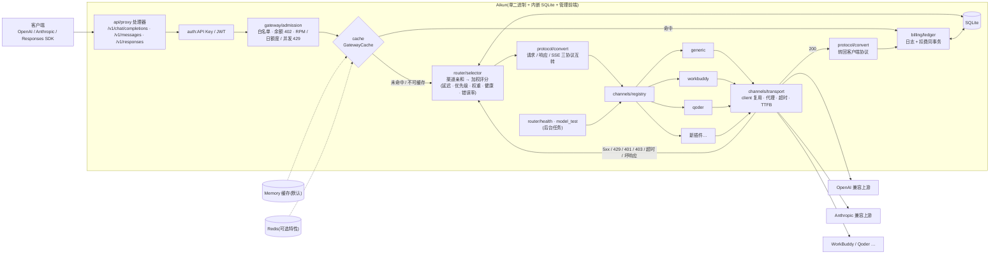
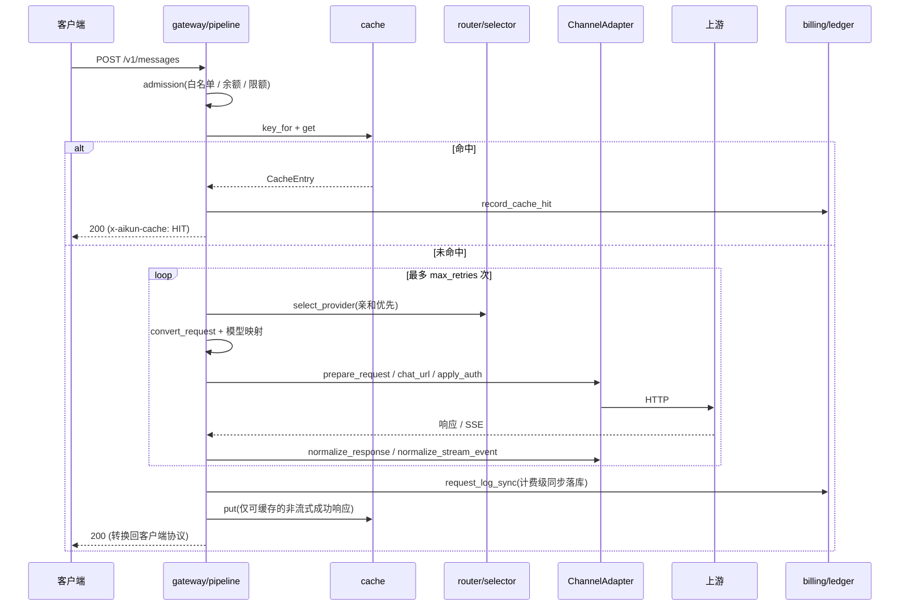

# Aikun 模块化重构方案(refactor/modular-gateway)

> 状态:**第一阶段已实现**(分支 `refactor/modular-gateway`,`cargo build` / `cargo test` 全部通过);第二阶段为后续计划。
>
> 来源标注:
> - **【用户 docs】**:来自仓库 `docs/` 中的重构思路
> - **【网关设计】**:来自此前讨论的模块化 AI 网关设计(协议层 / 路由层 / 插件渠道层 / 缓存层)
> - **【现有实现】**:Aikun v0.4.4 已有、本次保持不变的能力
> - **【本次新增】**:为把两者落到 Aikun 上而新增的决策

## 0. 关于「用户 docs」的说明(重要)

本次重构开始时(2026-11-16),GitHub 上 `zumpyx/Aikun` 的 `main` 与 `dev` 分支**都没有 `docs/` 目录**,最近一次推送是 2026-10-19(`v0.4.4`)。新写的重构思路很可能还在本地、没有 push。

因此本文档目前只合并了**【网关设计】**和**【现有实现】**。请把 docs 里的内容 push 上来,或直接贴到下面「0.1」一节,再逐条和第 2~7 节比对。冲突时以你的思路为准。

### 0.1 用户 docs 中的重构思路(待补)

| # | 思路 | 本方案对应位置 | 状态 |
|---|------|----------------|------|
| – | (待补充) | – | – |

---

## 1. 目标

1. **模块化**:按「协议层 / 网关管线 / 渠道插件 / 缓存 / 计费 / 路由」分层,每层职责单一、可单测。【网关设计】
2. **新增渠道足够简单**:新上游(WorkBuddy、Qoder 等)只需实现一个 trait 并注册一行,其余链路(选路、故障转移、计费、协议转换)不用改。【网关设计】
3. **缓存层**:可插拔后端,默认进程内存,Redis 可选。【网关设计】
4. **零功能回退**:现有能力一项不丢(见第 4 节对照表),对外 API 与数据库保持兼容。【本次新增】
5. **坚持单二进制零依赖**:默认构建不引入任何外部服务;Redis 只作为编译期可选特性。【现有实现】+【本次新增】

非目标:不改为 TOML 配置驱动。Aikun 的渠道、密钥、价格都存在 SQLite 里,由管理端维护,这比静态配置文件更适合运营场景。【网关设计】中的 TOML 路由表对应 Aikun 已有的「渠道 + 模型列表 + 模型映射 + 优先级 / 权重」。【本次新增】

## 2. 目标模块布局

```
src/
├── main.rs                 # 进程入口:配置、AppState、路由装配、后台任务、优雅关停
├── config.rs               # AIKUN_* 环境变量 / CLI(新增缓存配置项)
├── protocol/               # 【协议层】纯数据变换,不碰网络与数据库
│   └── convert.rs          #   OpenAI Chat ⇄ Anthropic Messages ⇄ OpenAI Responses(含 SSE 流式)
├── gateway/                # 【网关管线】
│   ├── admission.rs        #   准入:模型白名单、余额 402、RPM / 日额度 / 并发 429
│   └── pipeline.rs         #   缓存 → 选路 → 协议转换 → 插件发送 → 故障转移 → 流式 → 记账
├── channels/               # 【渠道插件层】
│   ├── mod.rs              #   ChannelAdapter trait(所有钩子都有默认实现)
│   ├── registry.rs         #   ChannelRegistry:channel_kind → 插件;唯一注册点
│   ├── transport.rs        #   公共 HTTP:client 复用(代理 + 超时)、URL 拼接、脱敏、发送
│   ├── generic.rs          #   通用 OpenAI / Anthropic 兼容(即重构前全部行为)
│   ├── workbuddy.rs        #   WorkBuddy(占位,待接真实协议)
│   └── qoder.rs            #   Qoder(占位,待接真实协议)
├── cache/                  # 【缓存层】
│   ├── mod.rs              #   CacheBackend trait、GatewayCache(策略 + 键)
│   ├── memory.rs           #   进程内 TTL + 容量淘汰(默认)
│   └── redis.rs            #   Redis(feature = "redis-cache")
├── router/                 # 【路由 / 健康】
│   ├── selector.rs         #   渠道亲和 + 加权评分选路、失败计数、自动禁用
│   ├── health.rs           #   周期健康检查(经插件鉴权)
│   └── model_test.rs       #   模型级测试矩阵
├── billing/                # 【计费】
│   ├── mod.rs              #   价格表(通配 / 兜底 / 缓存价)、整数微元折算、默认价格导入
│   ├── ledger.rs           #   请求日志 + 扣费同事务记账;缓存命中记账
│   └── default_prices.json
├── api/                    # HTTP 处理器(薄层)
│   ├── proxy/              #   /v1/chat/completions、/v1/messages、/v1/responses、/v1/models、透传
│   ├── admin/              #   渠道 / 用户 / 计费 / 渠道类型
│   └── auth.rs logs.rs redemption.rs
├── auth/ crypto.rs db/ models/ frontend/
```

重构前后对照:

| 重构前 | 重构后 | 说明 |
|---|---|---|
| `proxy/convert.rs` | `protocol/convert.rs` | 协议层独立 |
| `proxy/client.rs` | `channels/transport.rs` | 公共传输层,URL / 鉴权委托给插件 |
| `api/proxy/chat.rs`(1416 行:管线 + 准入 + 记账 + 处理器) | `gateway/pipeline.rs` + `gateway/admission.rs` + `billing/ledger.rs` + 53 行处理器 | 关注点分离 |
| `billing.rs`、`default_prices.json` | `billing/mod.rs`、`billing/default_prices.json` | 计费模块化 |
| 鉴权头逻辑在 client / health / fetch-models 三处复制 | `ChannelAdapter::apply_auth` 一处 | 消除重复 |
| 5 处手写渠道查询列 | `models::PROVIDER_SELECT_COLUMNS` | 加列不再漏改 |

## 3. 架构图



单个请求的时序:



## 4. 现有功能映射(功能对照)

| 现有能力【现有实现】 | 新位置 | 状态 |
|---|---|---|
| OpenAI / Anthropic / Responses 三端点 + 自动双向转换(含流式、工具调用、图片、thinking / reasoning、cache_control) | `protocol/convert.rs` + `gateway/pipeline.rs` | ✅ 原样迁移 |
| embeddings / moderations / images / rerank 字节级透传 | `api/proxy/passthrough.rs`(鉴权改走插件) | ✅ |
| 多渠道聚合、加权选路、渠道亲和(Key + 模型钉渠道) | `router/selector.rs` | ✅ 未改 |
| 故障转移(5xx / 429 / 408 / 401 / 403 / 传输错误 / 200 坏信封 / 非 SSE / 空流 / 流内错误帧) | `gateway/pipeline.rs` | ✅ |
| 连续失败 / 凭证失效自动禁用、渠道级 max_retries、TTFB / 空闲超时、整体 deadline | `router/selector.rs` + `gateway/pipeline.rs` + `channels/transport.rs` | ✅ |
| 渠道级 Socks5 / HTTP 代理、client 复用 | `channels/transport.rs` | ✅ |
| 渠道 key 静态加密、哈希查重、批量添加、副本 | `api/admin/providers.rs`、`crypto.rs` | ✅(副本会复制 channel_kind) |
| 健康检查、模型测试矩阵、获取上游模型列表 | `router/health.rs`、`router/model_test.rs`、`api/admin/providers.rs`(鉴权 / URL 改走插件) | ✅ |
| 计费:价格表、通配 / 兜底、缓存 token 价、整数微元、402、usage_daily 聚合 | `billing/` | ✅ |
| API Key:限流 / 日额度 / 并发 / 模型白名单 / 过期 | `gateway/admission.rs`、`auth/` | ✅ |
| 兑换码、钱包、用户管理、日志统计 | `api/*` | ✅ 未改 |
| 内嵌前端、CSP、CORS 白名单、JWT 安全、登录限流 | `main.rs`、`frontend/` | ✅(渠道表单新增「渠道类型」) |
| SQLite 单文件、自动迁移、schema 降级闸门 | `db/` | ✅(只加一列,不升 schema 版本) |
| 单二进制 musl 静态构建、Docker、Release 流水线 | 不变 | ✅(默认不编译 Redis) |
| 优雅关停(在途流先记账再退出) | `gateway/pipeline.rs` | ✅ |

测试:重构前 130 个单元测试 + 38 个 e2e 测试;重构后 141 + 41,全部通过,原有用例一个都没改断言。

## 5. 渠道插件设计【网关设计】→ 落地到 Aikun【本次新增】

### 5.1 接口

```rust
pub trait ChannelAdapter: Send + Sync + 'static {
    fn kind(&self) -> &'static str;                 // 写入 providers.channel_kind
    fn label(&self) -> &'static str;                // 管理端展示名
    fn description(&self) -> &'static str { "" }
    fn experimental(&self) -> bool { false }        // 占位插件,管理端加 ⚠ 提示
    fn endpoint_path(&self, protocol: &str) -> &'static str { /* /chat/completions | /messages | /responses */ }
    fn chat_url(&self, p: &Provider, protocol: &str) -> String { /* base_url_for + endpoint_path */ }
    fn models_url(&self, base_url: &str, protocol: &str) -> String { /* …/models */ }
    fn apply_auth(&self, req: RequestBuilder, api_key: &str, protocol: &str) -> RequestBuilder { /* Bearer / x-api-key */ }
    fn prepare_request(&self, p: &Provider, protocol: &str, body: &mut Value) {}
    fn normalize_response(&self, protocol: &str, body: &mut Value) {}
    fn normalize_stream_event(&self, protocol: &str, ev: &mut SseEvent) {}
}
```

设计取舍:

- **插件只描述「和标准协议有哪些不同」**,网络 I/O、超时、代理、故障转移、协议转换、计费都留在公共层。所以一个新插件通常只要十几行。和【网关设计】中的 `Channel::chat()/chat_stream()` 相比,这样不会让每个插件重复实现重试、流式解析和计费。
- **同步钩子 + 手写 BoxFuture**:不引入 `async-trait` 依赖,trait 可以 dyn。
- 插件的输入输出都是协议层的 `serde_json::Value` / `SseEvent`,与 Aikun 已经很完善的 Value 级转换器直接衔接。没有照搬【网关设计】中的强类型内部模型,因为 Aikun 的转换器覆盖面更广(Responses、thinking、cache_control、流内错误帧等)。

### 5.2 数据模型

- `providers.channel_kind TEXT NOT NULL DEFAULT ''`,空串表示 `generic`。
- **不加 CHECK 约束**:合法值由应用层注册表校验(`POST/PATCH /api/admin/providers` 返回 400 `invalid_channel_kind`)。新增插件不需要改表,也不需要重建表。
- 只加列、不升 `SCHEMA_VERSION`:旧二进制按显式列名查询,会忽略这一列,降级运行时所有渠道按 generic 工作,与重构前一致。
- 库里出现未注册的 kind(例如更新版本写入的)时回退 generic,并打 warn 日志。
- 新接口 `GET /api/admin/channel-kinds` 供前端下拉框使用。

### 5.3 新增一个渠道(三步)

1. `src/channels/xxx.rs`:`pub struct XxxAdapter; impl ChannelAdapter for XxxAdapter { fn kind(&self) -> &'static str { "xxx" } fn label(&self) -> &'static str { "Xxx" } /* 按需覆写钩子 */ }`
2. `src/channels/mod.rs` 加 `pub mod xxx;`;在 `ChannelRegistry::builtin()` 里加 `reg.register(Arc::new(xxx::XxxAdapter));`
3. 在管理端添加渠道时,从「渠道类型(插件)」里选 `Xxx`。

上游本来就兼容 OpenAI / Anthropic 时,不需要写代码,用 generic 即可。

### 5.4 WorkBuddy / Qoder

目前是**占位插件**:行为等同 generic(按 OpenAI 兼容协议转发),只是单独成为一个 kind,带 experimental 标记。拿到真实接口文档或抓包样例后,只需改各自的文件(URL、鉴权、请求 / 响应 / 流事件修补)。

## 6. 缓存层设计【网关设计】→ 落地到 Aikun【本次新增】

| 项 | 取值 / 默认 | 说明 |
|---|---|---|
| `AIKUN_CACHE_MODE` | **`off`** / deterministic / always | 默认关闭,保证升级后行为不变;deterministic 只缓存 `temperature == 0` |
| `AIKUN_CACHE_BACKEND` | **`memory`** / redis | memory 为进程内、零依赖;redis 需 `cargo build --features redis-cache` |
| `AIKUN_CACHE_TTL_SECS` | 300 | |
| `AIKUN_CACHE_MAX_ENTRIES` | 10000 | 内存后端容量上限,超出后先清过期项,再按插入顺序淘汰 |
| `AIKUN_CACHE_MAX_ENTRY_BYTES` | 1 MiB | 超过上限的大响应不缓存 |
| `AIKUN_CACHE_SCOPE` | **`user`** / global | 默认按用户隔离,防止 A 用户的响应被 B 用户命中 |
| `AIKUN_CACHE_HIT_BILLING` | **`full`** / free | 命中照常按缓存的用量计费(中转站收入不受影响),也可以设为免费 |
| `AIKUN_REDIS_URL` | – | backend=redis 时必填 |

语义:

- 只缓存**非流式**、上游 200 且通过协议形状校验的响应;缓存的是**已经转换成客户端协议**的响应体,所以键里包含客户端协议。
- 键 = `SHA-256("aikun-cache:v1" | 作用域 | 客户端协议 | 规范化请求体)`,规范化时去掉 `stream` / `stream_options`,对象键排序。
- **准入检查全部通过后才查缓存**:白名单、余额 402、RPM / 日额度 / 并发都不能被缓存绕过。
- 命中时写一条成功日志(`provider_id` 为 NULL、`latency_ms = 0`、用量照记),不触达上游,也不影响渠道健康指标和渠道亲和。
- `Cache-Control: no-cache` / `no-store` 跳过缓存;可缓存的请求会在响应头里带 `x-aikun-cache: HIT|MISS`。
- 后端故障一律 fail-open:读失败按未命中处理,写失败只记日志。

**与「上游提示缓存」的区别**:Aikun 已有的「渠道亲和」是为了命中**上游**的 prompt cache(按渠道分开);本缓存层是**网关**侧对完全相同请求的响应复用。两者互补。

## 7. 迁移步骤

### 第一阶段(本分支,已完成)

| 提交 | 内容 |
|---|---|
| `chore: 锁定依赖版本以兼容 rustc 1.85` | 可选。只为在 1.85 工具链上编译;CI 用更新的工具链时可以丢弃(见第 8 节) |
| `refactor(protocol)` | `proxy/convert.rs` → `protocol/convert.rs` |
| `refactor(gateway)` | 拆分 `api/proxy/chat.rs` → `gateway/pipeline.rs`、`gateway/admission.rs`、`billing/ledger.rs` |
| `feat(channels)` | ChannelAdapter + 注册表 + `channel_kind` 列 + 管理端下拉 + workbuddy / qoder 占位 |
| `feat(cache)` | 缓存层 + 配置项 + e2e |
| `docs` | 本文档 + README |

每一步都单独保证 `cargo build` 和 `cargo test --locked` 通过,可以逐个 review 或 cherry-pick。

### 第二阶段(建议,未实现)

1. **拆分 `protocol/convert.rs`(3478 行)**:按 `openai_anthropic.rs` / `responses.rs` / `stream/*.rs` / `usage.rs` 拆开,纯机械搬移。
2. **接入 WorkBuddy / Qoder 真实协议**(需要接口文档或请求样例)。
3. **插件级流式钩子增强**:目前 `normalize_stream_event` 只能逐事件修补;如果某个厂商用的不是 SSE(例如 NDJSON),需要增加 `decode_stream(bytes) -> Vec<SseEvent>` 钩子。
4. **管线进一步分层**:把 `attempt_loop` 中「发送 + 结果分类」抽成 `gateway/attempt.rs`,让流式与非流式共用失败分类表。
5. **缓存观测**:管理端展示命中率;`request_logs` 增加 `cache_hit` 列(需要加列迁移)。
6. **Redis 实机验证**:当前 Redis 后端只做了编译验证,没有接真实 Redis 跑过。
7. 可选的 `Azure` 插件(`api-key` 头 + deployments URL)。以前因为 `apply_auth` 不支持 `api-key` 头而被禁用,有了插件层之后是自然的扩展点。

## 8. 风险与对策

| 风险 | 对策 |
|---|---|
| 大规模搬移引入回归 | 搬移与功能变更分开提交;原有 168 个测试不改断言、全部通过;新增 14 个测试 |
| 新列影响降级 | 只加列、不加 CHECK、不升 schema 版本;旧二进制忽略该列 |
| 缓存导致串号或计费流失 | 默认关闭;默认按用户隔离;默认命中照常计费;准入先于缓存 |
| 缓存占用内存 | 条目上限 + 单条大小上限 + TTL |
| Redis 不可用 | fail-open;默认构建不包含 Redis |
| 插件 kind 拼写错误 / 未注册 | API 层 400 校验;运行时回退 generic 并打 warn |
| 依赖 MSRV | `chore` 提交把 `idna_adapter` / `time` / `simple_asn1` 降到兼容 rustc 1.85 的版本;如果 CI 工具链 ≥ 1.88 不需要它:可以在合并后执行 `cargo update -p idna_adapter -p time -p simple_asn1` 恢复新版本(直接 rebase 丢弃会与后续提交的 Cargo.lock 改动冲突),对代码没有影响 |
