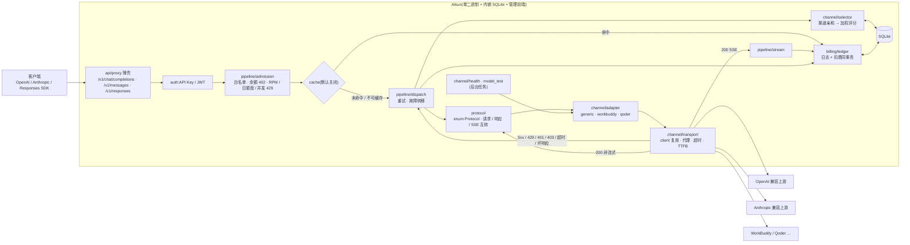

# Aikun 重构方案与进度(refactor/modular-gateway)

> 状态:roadmap-v0.5 **阶段 0(除 CI 门禁)与阶段 1 已完成**;阶段 2–4 未开始。
> 分支 `refactor/modular-gateway`,`cargo build` 零告警,`cargo test --locked` 全绿(148 单测 + 42 e2e;基线 v0.4.4 为 130 + 38)。
>
> **优先级:`docs/roadmap-v0.5.md`(用户定稿路线图)> 本文。** 两者冲突时以 roadmap 为准;本文只记录落地方式、roadmap 未覆盖的用户需求,以及各条目的进度。
>
> 来源标注:
> - **【用户 roadmap】**:`docs/roadmap-v0.5.md`(状态"已定稿,施工中以此为准")
> - **【用户需求】**:与用户沟通中明确提出、roadmap 未覆盖的需求(缓存层;WorkBuddy / Qoder 等新渠道好接入)
> - **【网关设计】**:此前讨论的模块化 AI 网关设计(协议层 / 路由 / Channel trait + 注册表 / CacheBackend)
> - **【现有实现】**:Aikun v0.4.4 已有、保持不变的能力
> - **【本次新增】**:为落地上述各项新做的决策

## 0. 用户 roadmap 与本方案的合并

### 0.1 用户 roadmap 要点【用户 roadmap】

**定位**:0.5 是重构版(还债版),不新增大的对外能力。**每个阶段结束时 e2e 必须全绿,禁止推倒重写。**

**必须保留的三项资产**:三端点单管线(`proxy_completion`)、以 OpenAI chat 为枢纽的星型协议转换、微元整数计费 + 单事务落库。

**四条关键决策**:
1. passthrough 改为管线的一种模式(`NoConversion + OpenAiOnly + NoStream`),不再单独维护第四条管线;
2. `enum Protocol` + 穷举 match,消灭静默兜底;
3. 转换边界类型化,枢纽维持 Value 树(不做全面 IR 重写);
4. 拓扑走缓存、事实走 DB:渠道 registry 快照、价格缓存、日额度计数器表。

**明确不做**:多实例 / 状态外置 Redis / PostgreSQL(仓储 trait 留缝即可)、插件系统、前端框架化、新的管理端大功能。

| # | roadmap 条目 | 阶段 | 本分支状态 |
|---|---|---|---|
| P0-1 | passthrough 复刻整条管线 | 2 | ⏳ 未开始 |
| P0-2 | God function / 14 参 `attempt_loop`、11 参 `stream_response` | 2 | 🟡 已分到 `pipeline/dispatch.rs` / `pipeline/stream.rs`(纯移动),`RequestCtx` 与拆小未做 |
| P0-3 | convert.rs 巨石 + `&'static str` 协议 + 静默兜底 | 1 | ✅ 已拆为 `protocol/` 目录树;`enum Protocol` 穷举 match |
| P0-4 | handler 内写 SQL、无仓储层、db 反向调用 billing 播种 | 3 | ⏳ 未开始 |
| P1-5 | 热路径全表扫描(选路 / 价格 / 日额度 SUM) | 3 | ⏳ 未开始 |
| P1-6 | 3 个潜伏 bug | 0 | ✅ 已修,各有回归测试 |
| P2-7 | 测试哑铃形、缺登录 e2e | 0 / 2 | 🟡 登录链路 e2e 已补;handler 单测留到阶段 2 |
| P2-8 | CI 无 fmt / clippy、无 CHANGELOG、providers.js 弹窗重复 | 0 / 4 | 🟡 CHANGELOG 已建;fmt / clippy 门禁未上(见 7.1);前端去重在阶段 4 |
| P2-9 | 无 request_id / metrics | 2 / 4 | ⏳ 未开始 |

### 0.2 冲突与裁决

| # | 冲突点 | 此前方案 | roadmap | 裁决 |
|---|---|---|---|---|
| 1 | 模块命名与目录 | `gateway/`、`channels/`、`router/`、`protocol/convert.rs` 单文件 | `pipeline/`、`channel/`、`protocol/{openai,anthropic,responses}/` | **按 roadmap 改名**:`gateway/` → `pipeline/`,`channels/` + `router/` → `channel/`,convert.rs 按 roadmap 拆分 |
| 2 | 渠道"插件"层 | `channels/` 插件 trait + 注册表 | 明确不做插件系统 | **保留 `ChannelAdapter`,但重新定位为编译期静态适配器**:位于 `channel/adapter/`,不支持动态加载,不提供外部 ABI,文案统一改为"适配器"。理由:【用户需求】明确要求新渠道(WorkBuddy、Qoder)容易接入,适配器只是把原先散落在 client / health / fetch-models 三处的 URL 与鉴权逻辑收成一处,与 roadmap 要求 health 复用 `apply_auth` 方向一致。`channel/registry.rs` 这个名字留给 roadmap 阶段 3 的渠道快照 |
| 3 | Redis 缓存后端 | `redis-cache` 编译特性 | 明确不做状态外置 Redis | **删除 Redis 后端与特性**,同时删掉 `AIKUN_CACHE_BACKEND` / `AIKUN_REDIS_URL`。`CacheBackend` trait 保留为接缝,唯一实现是进程内 `MemoryCache` |
| 4 | 响应缓存这个新功能本身 | 新增网关侧缓存 | 0.5 不新增大的对外能力 | **保留,默认关闭**(`AIKUN_CACHE_MODE=off`,升级后行为不变)。理由:【用户需求】明确提出;实现局限在 `cache/` 加管线里一个分支。按 roadmap 纪律在 CHANGELOG 单列"新增"条目。若要严格按 roadmap 执行,可以把 `feat(cache)` 与 `feat(channels)` 两个提交拆到单独分支,其余提交不依赖它们的行为 |
| 5 | 协议标识 | `&'static str` 常量 | `enum Protocol` | **按 roadmap**:`protocol::Protocol`,字符串只出现在 DB / 日志 / JSON 边界 |
| 6 | 管线拆分粒度 | `gateway/pipeline.rs` 单文件 | `pipeline/{mod,context,dispatch,stream,error}.rs` | **按 roadmap 落文件**:`mod.rs` / `dispatch.rs` / `stream.rs` / `admission.rs` 已就位;`context.rs`(RequestCtx)与 `error.rs`(GatewayError)属于阶段 2,未做 |
| 7 | 错误形状归属 | 留在网关管线 | 下沉到 `protocol/` | **按 roadmap**:`protocol/error.rs` |
| 8 | 后续计划 | 自拟的"第二阶段"清单 | 阶段 0–4 | **作废自拟清单**,统一用 roadmap 的阶段编号(第 7 节);自拟清单里 roadmap 未覆盖的条目(WorkBuddy / Qoder 真实协议、Azure 适配器、缓存命中率)列为"roadmap 外待办" |
| 9 | 配置方式 | 【网关设计】用 TOML 路由表 | 未提及 | **不引入 TOML**(此前已定):渠道、密钥、价格都在 SQLite,由管理端维护 |

---

## 1. 目标

1. **按 roadmap-v0.5 还债**:分层清晰、pipeline 显式化、协议强类型,同时保留三项资产。【用户 roadmap】
2. **新增渠道足够简单**:兼容上游零代码;特殊上游实现一个 trait,再注册一行。【用户需求】+【网关设计】
3. **可选的网关侧响应缓存**:默认关闭,进程内,零外部依赖。【用户需求】+【网关设计】
4. **零功能回退**:现有能力一项不丢(见第 4 节),对外 API 与数据库保持兼容。【现有实现】
5. **单二进制零依赖**:不引入任何外部服务。【现有实现】+【用户 roadmap】(明确不做 Redis / PostgreSQL)

## 2. 模块布局(当前实际)

```
src/
├── main.rs                 # 进程入口:配置、AppState、路由装配、后台任务、优雅关停
├── config.rs               # AIKUN_* 环境变量 / CLI
├── api/                    # HTTP 处理器
│   ├── proxy/              #   /v1/chat/completions · /v1/messages · /v1/responses(薄壳)· /v1/models · passthrough
│   ├── admin/              #   渠道 / 用户 / 计费 / 渠道类型
│   └── auth.rs logs.rs redemption.rs
├── pipeline/               # 【roadmap 目标架构】请求管线
│   ├── mod.rs              #   编排:准入 → 缓存 → dispatch;模型映射、响应体读取
│   ├── admission.rs        #   模型白名单、余额 402、RPM / 日额度 / 并发 429
│   ├── dispatch.rs         #   attempt_loop:选路 → 转换 → 发送 → 形状校验 → 故障转移
│   └── stream.rs           #   stream_response + StreamAbortGuard
├── protocol/               # 【roadmap 目标架构】纯数据变换,不碰网络与数据库
│   ├── mod.rs              #   enum Protocol;convert_request / convert_response / valid_response_shape(穷举)
│   ├── sse.rs              #   SSE 字节解析
│   ├── usage.rs            #   usage 提取与缓存拆分口径
│   ├── stream.rs           #   StreamConverter 调度(按客户端 × 上游组合各状态机)
│   ├── error.rs            #   各协议错误形状 / 流内错误事件 / 终止帧
│   ├── openai/             #   request.rs(→Anthropic)· response.rs · stream.rs(OaStreamState、OarStreamState)
│   ├── anthropic/          #   request.rs(→OpenAI)· response.rs · stream.rs(AnStreamState)
│   └── responses/          #   request.rs(→OpenAI)
├── channel/                # 【roadmap 目标架构】
│   ├── adapter/            #   【用户需求】ChannelAdapter + 静态注册表;generic / workbuddy / qoder
│   ├── transport.rs        #   client 复用(代理 + 超时)、URL 拼接、脱敏、发送、read_json_limited
│   ├── selector.rs         #   渠道亲和 + 加权评分、失败计数、自动禁用(阶段 3 改为吃快照的纯函数)
│   ├── health.rs           #   周期健康检查、日志分批清理
│   └── model_test.rs       #   模型级测试矩阵
├── cache/                  # 【用户需求】CacheBackend trait + memory.rs(默认关闭)
├── billing/                # 价格表、微元折算、默认价格;ledger.rs 日志 + 扣费同事务
└── auth/ crypto.rs db/ models/ frontend/
```

与 roadmap 目标架构的差距:`pipeline/context.rs`、`pipeline/error.rs`(阶段 2);`channel/registry.rs` 快照、`store/`、`state.rs` Limiter、价格缓存、日额度计数器表(阶段 3)。

重构前后对照:

| v0.4.4 | 本分支 | 说明 |
|---|---|---|
| `proxy/convert.rs`(3478 行) | `protocol/` 目录树(16 个文件) | 纯移动,65 个单测随实现文件迁移 |
| 协议 `&'static str` + `_ =>` 兜底 | `enum Protocol` + 穷举 match | 加入假协议后编译器在 18 处报错(已人工验证) |
| `api/proxy/chat.rs`(1416 行) | `pipeline/{mod,dispatch,stream,admission}.rs` + `billing/ledger.rs` + 薄壳处理器 | 纯移动 |
| `chat.rs` 里的 `protocol_error` 等 4 个函数 | `protocol/error.rs` | 协议形状知识归位 |
| `proxy/client.rs` | `channel/transport.rs` | URL / 鉴权委托给适配器 |
| 鉴权头逻辑在 client / health / fetch-models 三处复制 | `ChannelAdapter::apply_auth` 一处 | roadmap 阶段 1"health 复用 apply_auth" |
| `read_json_limited` 两份 | `channel/transport.rs` 一份(参数化) | 对外错误文案逐字不变 |
| `RequestLog.cost: f64` | `i64` 微元 | 只在 API 序列化时转成元 |
| base URL 回退逻辑三处手写 | `models::pick_base_url` | |
| 5 处手写渠道查询列 | `models::PROVIDER_SELECT_COLUMNS` | 行映射彻底集中由阶段 3 的 store 完成 |

## 3. 架构图



## 4. 现有功能对照【现有实现】

| 现有能力 | 位置 | 状态 |
|---|---|---|
| 三端点 + 自动双向转换(流式、工具调用、图片、thinking / reasoning、cache_control) | `protocol/` + `pipeline/` | ✅ 原样迁移 |
| embeddings / moderations / images / rerank 字节级透传 | `api/proxy/passthrough.rs`(鉴权走适配器) | ✅ 未改,阶段 2 并入管线 |
| 多渠道聚合、加权选路、渠道亲和 | `channel/selector.rs` | ✅ |
| 故障转移(5xx / 429 / 408 / 401 / 403 / 传输错误 / 坏信封 / 空流 / 流内错误帧) | `pipeline/dispatch.rs`、`pipeline/stream.rs` | ✅ |
| 自动禁用、max_retries、TTFB / 空闲超时、整体 deadline | `channel/selector.rs`、`pipeline/`、`channel/transport.rs` | ✅ |
| 渠道代理、client 复用、key 加密、哈希查重、批量添加、副本 | `channel/transport.rs`、`api/admin/providers.rs`、`crypto.rs` | ✅ |
| 健康检查、模型测试矩阵、获取上游模型 | `channel/health.rs`、`channel/model_test.rs` | ✅ |
| 计费(通配 / 兜底 / 缓存价 / 微元 / 402 / usage_daily) | `billing/` | ✅ |
| API Key 限流 / 日额度 / 并发 / 白名单 / 过期 | `pipeline/admission.rs`、`auth/` | ✅ |
| 兑换码、钱包、用户管理、日志统计 | `api/*` | ✅(钱包统计按修复 ② 合并 usage_daily) |
| 内嵌前端、CSP、CORS、JWT、登录限流 | `main.rs`、`frontend/` | ✅(渠道表单新增"渠道类型(适配器)") |
| SQLite、自动迁移、schema 降级闸门 | `db/` | ✅(只加 `channel_kind` 一列,不升 schema 版本) |
| 单二进制、Docker、Release | 不变 | ✅ |
| 优雅关停(在途流先记账) | `pipeline/` | ✅ |

## 5. 渠道适配器【用户需求】+【网关设计】→ 落地方式【本次新增】

**不是插件系统**(见 0.2 第 2 条):适配器编译进二进制,在 `ChannelRegistry::builtin()` 里静态注册。

```rust
pub trait ChannelAdapter: Send + Sync + 'static {
    fn kind(&self) -> &'static str;                 // 写入 providers.channel_kind
    fn label(&self) -> &'static str;                // 管理端展示名
    fn description(&self) -> &'static str { "" }
    fn experimental(&self) -> bool { false }        // 占位适配器,管理端显示 ⚠
    fn endpoint_path(&self, protocol: Protocol) -> &'static str { /* 穷举 match */ }
    fn chat_url(&self, p: &Provider, protocol: Protocol) -> String { /* base_url_for + endpoint_path */ }
    fn models_url(&self, base_url: &str, protocol: Protocol) -> String { /* …/models */ }
    fn apply_auth(&self, req: RequestBuilder, api_key: &str, protocol: Protocol) -> RequestBuilder { /* Bearer / x-api-key */ }
    fn prepare_request(&self, p: &Provider, protocol: Protocol, body: &mut Value) {}
    fn normalize_response(&self, protocol: Protocol, body: &mut Value) {}
    fn normalize_stream_event(&self, protocol: Protocol, ev: &mut SseEvent) {}
}
```

- 适配器只描述"这个上游和标准协议有什么不同"。网络 I/O、超时、代理、故障转移、协议转换、计费都留在公共层,所以一个新适配器通常只要十几行。
- 钩子都是同步的,不引入 async-trait;钩子吃 `Protocol` 枚举。
- 数据模型:`providers.channel_kind TEXT NOT NULL DEFAULT ''`,空串表示 generic。不加 CHECK,由 API 层校验,不合法时返回 400 `invalid_channel_kind`;库里出现未注册的值时回退 generic 并打 warn。只加列,不升 `SCHEMA_VERSION`。
- `GET /api/admin/channel-kinds` 给前端下拉使用。
- **新增渠道三步**:① 新建 `src/channel/adapter/xxx.rs`,`impl ChannelAdapter`;② 在 `adapter/mod.rs` 加 `pub mod xxx;`,并在 `ChannelRegistry::builtin()` 里注册一行;③ 在管理端选择该渠道类型。
- **WorkBuddy / Qoder**:目前是占位实现(行为等同 generic,带 experimental 标记),要等拿到真实接口文档后才能接入。

## 6. 响应缓存【用户需求】→ 落地方式【本次新增】

| 配置 | 默认 | 说明 |
|---|---|---|
| `AIKUN_CACHE_MODE` | **`off`** / deterministic / always | 默认关闭,升级后行为不变;deterministic 只缓存 `temperature == 0` 的请求 |
| `AIKUN_CACHE_TTL_SECS` | 300 | |
| `AIKUN_CACHE_MAX_ENTRIES` | 10000 | 超出后先清过期项,再按插入顺序淘汰 |
| `AIKUN_CACHE_MAX_ENTRY_BYTES` | 1 MiB | 更大的响应不缓存 |
| `AIKUN_CACHE_SCOPE` | **`user`** / global | 默认按用户隔离 |
| `AIKUN_CACHE_HIT_BILLING` | **`full`** / free | 命中时默认照常计费 |

- 后端只有进程内内存一种;Redis 后端已按 roadmap 删除(0.2 第 3 条)。
- 只缓存非流式、上游 200 且通过形状校验的响应;缓存的是已转换成客户端协议的响应体。
- 键 = `SHA-256("aikun-cache:v1" | 作用域 | 客户端协议 | 规范化请求体)`。
- **准入先于缓存**:白名单、402、429 都不会被缓存绕过。命中时也写日志(`provider_id` 为 NULL),不影响渠道健康与亲和。
- 遇到 `Cache-Control: no-cache` / `no-store` 时跳过缓存;响应头带 `x-aikun-cache: HIT|MISS`。
- 与"渠道亲和"互补:亲和是为了命中上游的 prompt cache,本缓存是网关侧复用完全相同的请求。

## 7. 阶段进度【用户 roadmap】

### 7.1 阶段 0:准备(可先发 0.4.5)

| 条目 | 状态 | 落地 |
|---|---|---|
| CI 加 `cargo fmt --check` + `clippy -D warnings` | ⏳ **未做** | 构建机没有 rustfmt / clippy 组件,无法验证存量告警为零;直接加门禁会让 CI 变红。下一步应在装有完整工具链的环境里先清零告警,再改 `.github/workflows/ci.yml` |
| 修复 ① O→A usage 口径 | ✅ | `protocol/openai/response.rs`、`openai/stream.rs`(`OaStreamState::anthropic_usage`);回归测试 `response_openai_to_anthropic_splits_cached_tokens`、`stream_openai_to_anthropic_splits_cached_tokens` |
| 修复 ② wallet_stats 读 usage_daily | ✅ | `api/logs.rs::wallet_daily` 按日合并两表(purge 在同一事务里移动明细,不会重复计数);回归测试 `wallet_daily_survives_log_purge`。注意:模型分布仍只统计未清理的明细(usage_daily 没有模型维度) |
| 修复 ③ 日志清理分批 DELETE | ✅ | `channel/health.rs`:每批 5000 行,批间释放写锁,截止时间只算一次;回归测试 `purge_in_small_batches_matches_single_pass` |
| 建 CHANGELOG.md | ✅ | 补录 0.4.0–0.4.4,Unreleased 记录本分支全部变化 |
| e2e 补登录链路 | ✅ | `login_me_and_password_change_revokes_sessions`:登录、/api/me、错误密码、改密踢下线、禁用账户、匿名访问 |

### 7.2 阶段 1:结构重组(纯移动)

| 条目 | 状态 |
|---|---|
| convert.rs → `protocol/` 目录树,测试随实现文件迁移 | ✅ |
| `enum Protocol`,去掉 `_ =>` 兜底 | ✅ 不可达组合显式列出并注释,行为不变 |
| 4 个错误形状函数下沉到 `protocol/` | ✅ `protocol/error.rs` |
| `read_json_limited` 合一;health 复用 `apply_auth` | ✅ |
| `RequestLog.cost` 改 `i64` | ✅ |
| 验收:`src/protocol/` 无 `&'static str` 协议标识 | ✅ 剩余的 `&'static str` 都是 stop_reason / 错误类型映射与 `Protocol::as_str` |
| 验收:加入假协议后编译器在所有 match 处报错 | ✅ 人工验证 18 处 E0004 |

### 7.3 阶段 2–4(未开始)

- **阶段 2 管线显式化**:`RequestCtx`;拆小 `attempt_loop` / `stream_response`;passthrough 并入管线(动手前先给现行为补 e2e 快照);`pipeline/error.rs` GatewayError;request_id 与 `X-Request-Id`;管线单测。
- **阶段 3 性能与状态归位**:`channel/registry.rs` 渠道快照(加一个"缓存与 DB 一致"的防御测试);价格缓存;日额度计数器表;`state.rs` Limiter;`store/` 仓储层(`api/` 下 `conn.lock()` 清零);把价格播种从 db 层移出。
- **阶段 4 收尾**:前端治理(providers.js 弹窗去重、ESM、hash 路由);(待定)Gemini 协议验收;(待定)/metrics;发布 0.5.0。

### 7.4 roadmap 之外的待办【用户需求】

1. 接入 WorkBuddy / Qoder 真实协议(需要接口文档或请求样例)。
2. 适配器级流式解码钩子(上游不是 SSE 时,如 NDJSON)。
3. Azure 适配器(`api-key` 头 + deployments URL)。
4. 缓存观测:管理端命中率;`request_logs.cache_hit` 列。

### 7.5 本分支提交顺序

每个提交都单独保证 `cargo build` 和 `cargo test --locked` 通过。

1. `chore`:锁定依赖版本以兼容 rustc 1.85(可选,见第 8 节)
2. `refactor(protocol)` / `refactor(gateway)`:第一轮搬移(协议层独立、拆分 chat.rs)
3. `feat(channels)`、`feat(cache)`:【用户需求】的两项功能(默认不改变行为)
4. `docs`:第一版方案
5. `docs`:用户 roadmap(原样 cherry-pick)
6. `refactor`:模块对齐 roadmap(`pipeline/`、`channel/`)
7. `refactor(protocol)`:拆 convert.rs → enum Protocol + error.rs → 剩余分支改为穷举 match
8. `refactor`:合并 read_json_limited,cost 改 i64
9. `refactor(cache)`:删除 Redis 后端
10. `fix` ①③②,`test+docs` 登录 e2e 与 CHANGELOG
11. `docs`:本文按 roadmap 重写

## 8. 风险与对策

| 风险 | 对策 |
|---|---|
| 大规模搬移引入回归 | 搬移与行为变化分开提交;原有用例不改断言(唯一例外:`valid_response_shape` 的"未知协议放行"断言,因为未知协议已无法表示,改为断言 `Protocol::parse` 拒绝未知值) |
| 修复 ① 改变客户端可见的 usage | 只影响 OpenAI 上游 → Anthropic 客户端,且仅在上游报告了 cached_tokens 时;计费不变;已写入 CHANGELOG |
| 新列影响降级 | 只加列、不加 CHECK、不升 schema 版本 |
| 缓存串号或计费流失 | 默认关闭、按用户隔离、命中照常计费、准入先于缓存 |
| 适配器被当成插件系统扩张 | 文档与代码注释写明是编译期静态注册;不提供动态加载 |
| fmt / clippy 未验证 | 阶段 0 门禁待在完整工具链上补做(7.1) |
| 依赖 MSRV | `chore` 提交把 `idna_adapter` / `time` / `simple_asn1` 锁到兼容 rustc 1.85 的版本;CI 工具链 ≥ 1.88 时可以在合并后执行 `cargo update -p idna_adapter -p time -p simple_asn1` 恢复 |
